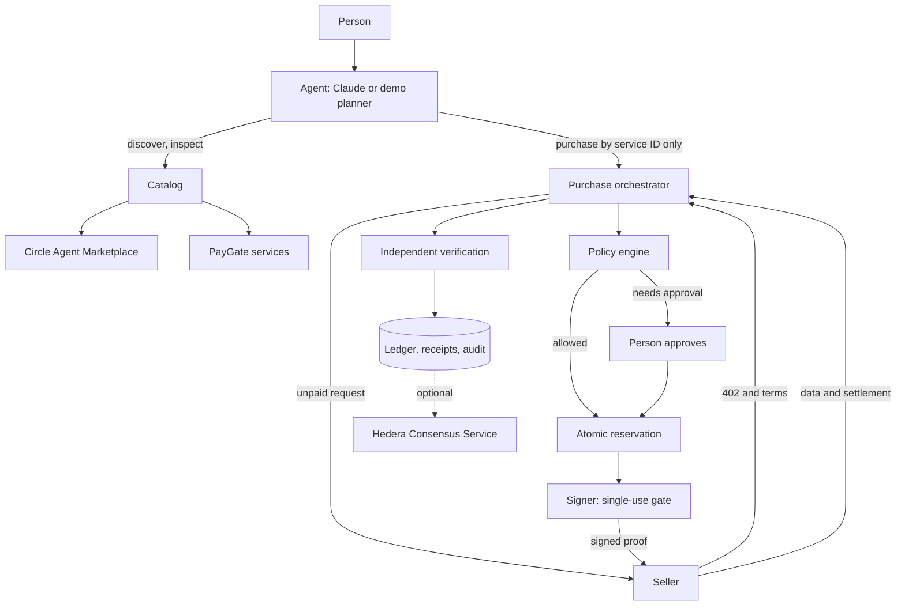

# PayGate

A spending firewall and payment layer for AI agents. You ask for something in plain language. The agent finds a paid API, your spending rules decide whether it can pay, and you get the result with a receipt.

> Arc helps AI agents discover services. PayGate ensures agents can purchase those services safely, transparently and within the user's budget.

The limits are enforced on the server, outside the AI. The model has no tool that accepts an amount, a recipient or an approval.

## Quick start

```bash
npm install
npm run dev
```

Open http://localhost:3000/agent and choose **Try the cricket example**.

With no configuration, PayGate runs in **demo mode**: no keys, no money, data in memory. It runs the real HTTP 402 handshake and the real firewall with a simulated payment rail. Everything it produces is labelled **Simulated**, and discovery still uses the live marketplace.

## What it does

- **AI agent:** Claude plans each request through three tools, with a labelled fixed planner when no key is set.
- **Spending Firewall:** per-request, daily, monthly and per-task limits, provider allowlist and blocklist, network permissions, an approval threshold, and an automatic-payment switch.
- **Discovery:** the live Circle Agent Marketplace, plus services registered on PayGate.
- **Payments:** Arc USDC through Circle Gateway nanopayments, and Hedera USDC through an x402 facilitator, behind one adapter interface.
- **Provider wallets:** providers connect a browser wallet (or paste an address) to receive Arc payments, and add a Hedera account ID for Hedera payments. No name service is required.
- **Reputation:** measured from real calls only. Below five calls it says "Not enough data".
- **Receipts and audit:** every payment gets a receipt, with optional Hedera Consensus Service publishing.
- **Provider dashboard:** register an API, set a price, and see revenue, failures and reputation.

## Architecture



| Path | Responsibility |
| --- | --- |
| `paygate-x402/` | Reusable x402 v2 seller middleware for any Web `Request`/`Response` server |
| `src/server/firewall/policy.ts` | The policy engine, a pure function |
| `src/server/store/` | `SpendStore`: atomic reservations and all records, in memory or Supabase |
| `src/server/signer/` | The only code that reads buyer keys, and the only path to a signature |
| `src/server/payments/` | `PaymentAdapter` with Arc, Hedera and demo implementations |
| `src/server/purchase.ts` | The buyer flow from quote to receipt |
| `src/server/agent/` | Claude tool loop, demo planner and budget parsing |
| `src/server/discovery/` | Circle catalog client and PayGate services |

## Payment flow

1. The agent names a service it discovered in this run. It cannot supply a URL, price or recipient.
2. PayGate requests the resource unpaid and reads the seller's real `402` terms.
3. It chooses the cheapest offer on an enabled network and checks provider identity.
4. The policy engine decides: allow, needs approval, or deny.
5. An atomic reservation re-checks budgets and duplicates. This stops concurrent requests overspending.
6. The signer moves that reservation from held to signing exactly once, for that exact requirement, and signs.
7. PayGate retries with `PAYMENT-SIGNATURE`.
8. The seller verifies, runs the handler, settles, and only then releases data.
9. PayGate confirms the payment itself instead of trusting the seller: through Circle Gateway, the Arc receipt, or the Hedera mirror node.
10. The ledger and receipt are written.

A held amount is only released when no money can have moved. If the outcome is unknown, for example the seller vanished after receiving the proof, the amount stays counted until someone reviews it.

Receipt statuses are **Verified** (settled and confirmed), **Settling** (accepted by Gateway, batch pending), **Unverified** (could not be confirmed), **Failed** and **Simulated** (demo).

## Going live on testnet

1. Copy `.env.example` to `.env.local`.
2. Create a Supabase project. Review `supabase/migrations/20261105000000_spending_firewall.sql` against any existing tables, then apply it.
3. In Supabase Auth, edit the magic link email template to include `{{ .Token }}`, since sign-in uses a typed code.
4. Add `ANTHROPIC_API_KEY`.
5. Create a new EOA wallet for the agent and set `AGENT_PRIVATE_KEY`. Set `PAYGATE_SELLER_ADDRESS` to a different wallet.
6. Get Arc testnet USDC from https://faucet.circle.com, then move it into Gateway:

   ```bash
   npm run wallet:status
   npm run wallet:deposit -- 1
   ```

7. Add `CRICAPI_KEY` from https://cricketdata.org.
8. Set `PAYGATE_MODE=live` and restart.

For Hedera, also set the `HEDERA_*` values. The agent and seller accounts must both be associated with the USDC token.

## Network configuration

| Network | CAIP-2 | Token | Rail | Status |
| --- | --- | --- | --- | --- |
| Arc Testnet | `eip155:5042002` | USDC `0x3600…0000` | Circle Gateway | Default |
| Hedera testnet | `hedera:testnet` | USDC `0.0.429274` | x402 facilitator | Default |
| Arc | `eip155:5042` | USDC `0x3600…0000` | Circle Gateway | Off unless `PAYGATE_ENABLE_MAINNET=true` |
| Hedera mainnet | `hedera:mainnet` | USDC `0.0.456858` | x402 facilitator | Off unless `PAYGATE_ENABLE_MAINNET=true` |

Arc and Hedera share nothing: each adapter has its own token, proof format and verification.

Base has been removed.

## API

All routes except `/api/x402/*` and `/api/auth/*` need a signed-in session. Identity always comes from the session, never the request body.

| Route | Purpose |
| --- | --- |
| `POST /api/agent/run` | Run the agent. Streams newline-delimited JSON events |
| `GET /api/overview` | Dashboard data, computed from the ledger |
| `GET`, `PUT /api/policy` | Read or change the spending policy |
| `POST /api/approvals/:id` | Approve or reject a held payment |
| `GET /api/transactions/:id` | Read a receipt |
| `GET /api/marketplace` | Search the catalog: `query`, `category`, `network`, `offset` |
| `GET`, `PUT /api/provider` | Provider profile, sales and reputation |
| `POST /api/provider/services` | Register an API |
| `DELETE /api/provider/services/:id` | Remove your API |
| `GET /api/x402/:serviceId` | A paid resource, using x402 v2 |
| `POST /api/auth/otp`, `/verify`, `/logout` | Sign-in |

## Using the middleware

```ts
import { withPayment } from 'paygate-x402';

export const GET = withPayment(async () => Response.json({ data: 'paid content' }), {
  offers: [{ adapter: arcAdapter, amountAtomic: '20000', payTo: sellerAddress }],
  replayGuard,
});
```

Write a `SellerAdapter` to add a network. The middleware only knows the protocol.

## Testing

| Command | What it covers |
| --- | --- |
| `npm test` | Policy engine, reservations, approvals, middleware, reputation, URL guard |
| `npm run test:e2e -- <url>` | The full journey against a running server in demo mode |
| `npm run test:live` | Real Arc, Gateway and Hedera, with throwaway unfunded keys. It cannot spend |
| `npm run test:mutation` | Breaks 20 protections one at a time and confirms the tests notice |

## Security

- Spending limits are enforced by server code and the database, never by the model.
- Buyer keys are read only in `src/server/signer/keys.ts`, and never reach a prompt, tool result or client bundle.
- Signing needs a live reservation bound to the exact requirement, and each reservation signs once.
- Each payment proof can be used once, enforced by a unique database key.
- Sellers release data only after settlement, because Gateway's `verify` checks signatures, not balances.
- Third-party text reaches the model marked as untrusted data, and a run can attempt at most three purchases.
- Catalog URLs are checked against private address ranges, with redirects off, a timeout and a size cap.
- Row-level security is on with no policies, so the public anon key can read nothing.
- Spend totals and verification status are always computed on the server.

### Known limits

- The signer is a module boundary, not a separate process. For production, move it to its own service or a KMS.
- Rate limiting is per server instance. Budgets do not depend on it.
- Unverified payments stay counted, and there is no reconciliation screen yet.
- Reputation is computed from calls made through this PayGate deployment.
- Provider revenue counts sales reported by PayGate's seller route.
# PayGate

