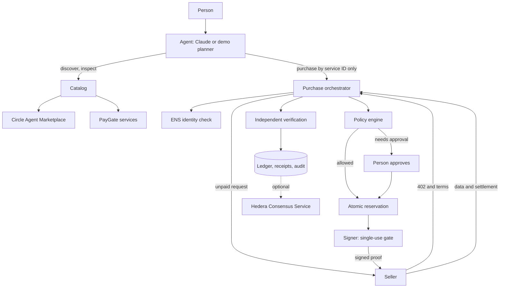

# PayGate

A spending firewall and payment layer for AI agents. You ask for something in plain language. The agent finds a paid API, your spending rules decide whether it can pay, and you get the result with a receipt.

> Arc helps AI agents discover services. PayGate ensures agents can purchase those services safely, transparently and within the user's budget.

The limits are enforced on the server, outside the AI. The model has no tool that accepts an amount, a recipient or an approval.

## Quick start

```bash
npm install
npm run dev
```

Open http://localhost:3000/agent and choose **Try the cricket example**.

With no configuration, PayGate runs in **demo mode**: no keys, no money, data in memory. It runs the real HTTP 402 handshake and the real firewall with a simulated payment rail. Everything it produces is labelled **Simulated**, and discovery still uses the live marketplace.

For how it works inside, see the [documentation](docs/README.md).

## What it does

- **AI agent:** Claude plans each request through three tools, with a labelled fixed planner when no key is set.
- **Spending Firewall:** per-request, daily, monthly and per-task limits, provider allowlist and blocklist, network permissions, an approval threshold, and an automatic-payment switch.
- **Discovery:** the live Circle Agent Marketplace, plus services registered on PayGate.
- **Payments:** Arc USDC through Circle Gateway nanopayments, and Hedera USDC through an x402 facilitator, behind one adapter interface.
- **Provider identity:** ENS names are checked against the payment address. A mismatch blocks payment.
- **Reputation:** measured from real calls only. Below five calls it says "Not enough data".
- **Receipts and audit:** every payment gets a receipt, with optional Hedera Consensus Service publishing.
- **Provider dashboard:** register an API, set a price, and see revenue, failures and reputation.

## Architecture



| Path | Responsibility |
| --- | --- |
| `paygate-x402/` | Reusable x402 v2 seller middleware for any Web `Request`/`Response` server |
| `src/server/firewall/policy.ts` | The policy engine, a pure function |
| `src/server/store/` | `SpendStore`: atomic reservations and all records, in memory or Supabase |
| `src/server/signer/` | The only code that reads buyer keys, and the only path to a signature |
| `src/server/payments/` | `PaymentAdapter` with Arc, Hedera and demo implementations |
| `src/server/purchase.ts` | The buyer flow from quote to receipt |
| `src/server/agent/` | Claude tool loop, demo planner and budget parsing |
| `src/server/discovery/` | Circle catalog client and PayGate services |

## Payment flow

1. The agent names a service it discovered in this run. It cannot supply a URL, price or recipient.
2. PayGate requests the resource unpaid and reads the seller's real `402` terms.
3. It chooses the cheapest offer on an enabled network and checks provider identity.
4. The policy engine decides: allow, needs approval, or deny.
5. An atomic reservation re-checks budgets and duplicates. This stops concurrent requests overspending.
6. The signer moves that reservation from held to signing exactly once, for that exact requirement, and signs.
7. PayGate retries with `PAYMENT-SIGNATURE`.
8. The seller verifies, runs the handler, settles, and only then releases data.
9. PayGate confirms the payment itself instead of trusting the seller: through Circle Gateway, the Arc receipt, or the Hedera mirror node.
10. The ledger and receipt are written.

A held amount is only released when no money can have moved. If the outcome is unknown, for example the seller vanished after receiving the proof, the amount stays counted until someone reviews it.

Receipt statuses are **Verified** (settled and confirmed), **Settling** (accepted by Gateway, batch pending), **Unverified** (could not be confirmed), **Failed** and **Simulated** (demo).

## Going live on testnet

1. Copy `.env.example` to `.env.local`.
2. Create a Supabase project. Review `supabase/migrations/20261105000000_spending_firewall.sql` against any existing tables, then apply it.
3. In Supabase Auth, edit the magic link email template to include `{{ .Token }}`, since sign-in uses a typed code.
4. Add `ANTHROPIC_API_KEY`.
5. Create a new EOA wallet for the agent and set `AGENT_PRIVATE_KEY`. Set `PAYGATE_SELLER_ADDRESS` to a different wallet.
6. Get Arc testnet USDC from https://faucet.circle.com, then move it into Gateway:

   ```bash
   npm run wallet:status
   npm run wallet:deposit -- 1
   ```

7. Add `CRICAPI_KEY` from https://cricketdata.org.
8. Set `PAYGATE_MODE=live` and restart.

For Hedera, also set the `HEDERA_*` values. The agent and seller accounts must both be associated with the USDC token.

## Network configuration

| Network | CAIP-2 | Token | Rail | Status |
| --- | --- | --- | --- | --- |
| Arc Testnet | `eip155:5042002` | USDC `0x3600…0000` | Circle Gateway | Default |
| Hedera testnet | `hedera:testnet` | USDC `0.0.429274` | x402 facilitator | Default |
| Arc | `eip155:5042` | USDC `0x3600…0000` | Circle Gateway | Off unless `PAYGATE_ENABLE_MAINNET=true` |
| Hedera mainnet | `hedera:mainnet` | USDC `0.0.456858` | x402 facilitator | Off unless `PAYGATE_ENABLE_MAINNET=true` |

Arc and Hedera share nothing: each adapter has its own token, proof format and verification.

Base has been removed.

## API

All routes except `/api/x402/*` and `/api/auth/*` need a signed-in session. Identity always comes from the session, never the request body.

| Route | Purpose |
| --- | --- |
| `POST /api/agent/run` | Run the agent. Streams newline-delimited JSON events |
| `GET /api/overview` | Dashboard data, computed from the ledger |
| `GET`, `PUT /api/policy` | Read or change the spending policy |
| `POST /api/approvals/:id` | Approve or reject a held payment |
| `GET /api/transactions/:id` | Read a receipt |
| `GET /api/marketplace` | Search the catalog: `query`, `category`, `network`, `offset` |
| `GET`, `PUT /api/provider` | Provider profile, sales and reputation |
| `POST /api/provider/services` | Register an API |
| `DELETE /api/provider/services/:id` | Remove your API |
| `GET /api/x402/:serviceId` | A paid resource, using x402 v2 |
| `POST /api/auth/otp`, `/verify`, `/logout` | Sign-in |

## Integrating PayGate

There are four ways in, depending on which side of the payment you are on.

| You want to | Use | Code to write |
| --- | --- | --- |
| Charge for an API you already run, without changing it | [Provider dashboard](#1-sell-an-existing-api-through-paygate-no-code) | None |
| Charge for routes inside your own server | [`paygate-x402` middleware](#2-add-payments-to-your-own-server) | A few lines plus an adapter |
| Let your app or agent buy data within spending limits | [PayGate HTTP API](#3-buy-through-paygate-from-your-app-or-agent) | An HTTP client |
| Pay a PayGate-hosted API from your own x402 client | [`/api/x402/:serviceId`](#4-pay-paygate-services-from-any-x402-client) | An x402 v2 client |

You can also [reuse the policy engine](#reusing-the-firewall-in-your-own-agent) on its own.

### 1. Sell an existing API through PayGate (no code)

PayGate hosts the paywall and proxies paid requests to your API.

1. Sign in and open `/provider`.
2. Fill in your provider profile:
   - **Wallet address**: the EVM address that receives USDC on Arc.
   - **ENS name** (optional): it must resolve to that wallet. Buyers check it before every payment and refuse to pay on a mismatch.
   - **Hedera account** (optional): needed if you accept Hedera, in the form `0.0.1234`.
   - **PayGate ID** (optional): a free `yourname.paygate.eth` subdomain.
3. Register a service with a name, description, public endpoint URL, price in USD (for example `0.02`) and the networks you accept.

Your API is then served at `GET /api/x402/<serviceId>` and appears in the marketplace and in agent discovery. For each call PayGate:

1. Returns `402` with your price and wallet.
2. Verifies the buyer's payment.
3. Calls your endpoint.
4. Settles only if your endpoint returned a `2xx`, then passes your response back.

If your API fails, nobody is charged. Sales, failures and measured reputation show on the provider dashboard.

The same steps work over HTTP. Authenticate as described in [section 3](#3-buy-through-paygate-from-your-app-or-agent), then:

```bash
curl -X PUT  "$PAYGATE/api/provider" -b cookies.txt -H 'content-type: application/json' \
  -d '{"name":"Acme Data","walletAddress":"0xYourWallet","ensName":"acme.eth"}'

curl -X POST "$PAYGATE/api/provider/services" -b cookies.txt -H 'content-type: application/json' \
  -d '{"name":"Acme weather","description":"Current weather by city","endpoint":"https://api.acme.com/weather",
       "category":"Weather","price":"0.01","supportedNetworks":["arc-testnet"]}'
```

Requirements for your endpoint:

- It must be a public `https` URL that answers `GET` with JSON. PayGate refuses private and internal addresses.
- PayGate calls it without credentials. Anyone who learns the URL can call it for free, so use a URL that is hard to guess, or protect it yourself with [option 2](#2-add-payments-to-your-own-server).
- Query parameters sent by buyers are not yet forwarded to your endpoint (see [Known limits](#known-limits)).

### 2. Add payments to your own server

[`paygate-x402`](paygate-x402/) is x402 v2 seller middleware that works on Web `Request` and `Response`. It runs in Next.js route handlers, Hono, Bun, Deno and Cloudflare Workers. Express and Fastify handlers use Node's `req`/`res` objects, so they need a bridge to Web `Request`/`Response` first.

```ts
import { withPayment } from 'paygate-x402';

export const GET = withPayment(
  async (request, { payer }) => Response.json({ data: 'paid content', payer }),
  {
    offers: [{ adapter: arcTestnet, amountAtomic: '10000', payTo: '0xYourWallet' }], // 10000 = $0.01 USDC
    replayGuard,
    description: 'Current weather by city',
  },
);
```

You supply:

- An **adapter** for each network you accept. It builds the price quote, verifies the buyer's proof and settles the payment.
- A **replay guard**, so one signed payment cannot unlock the resource twice.

Install and build steps, a working Arc adapter, a production replay guard and a Hono example are in [`paygate-x402/README.md`](paygate-x402/README.md). This repo's adapters are full references: [`arc.ts`](src/server/payments/arc.ts) and [`hedera.ts`](src/server/payments/hedera.ts).

Any x402 v2 buyer can pay you, including PayGate's agent, if your API is in the marketplace.

### 3. Buy through PayGate from your app or agent

Run PayGate (demo or live) and drive it over HTTP. Your app sends a plain-language request, and PayGate discovers, pays within your policy and returns the answer. Your app never holds a wallet key.

**Sign in.** In demo mode without Supabase, no sign-in is needed and everyone shares one demo user. With Supabase, use the email code flow. It sets an httpOnly `paygate_session` cookie, which you send with later calls:

```bash
curl -X POST "$PAYGATE/api/auth/otp"    -H 'content-type: application/json' -d '{"email":"you@example.com"}'
curl -X POST "$PAYGATE/api/auth/verify" -H 'content-type: application/json' -c cookies.txt \
  -d '{"email":"you@example.com","token":"123456"}'
```

**Set your limits.** Amounts are USD strings:

```bash
curl -X PUT "$PAYGATE/api/policy" -b cookies.txt -H 'content-type: application/json' -d '{
  "perRequestLimit":"0.50","dailyLimit":"1.00","monthlyLimit":"10.00","approvalThreshold":"0.20",
  "autoPayEnabled":true,"allowedNetworks":["arc-testnet"],"allowedProviders":[],"blockedProviders":[]}'
```

**Run the agent.** The response streams newline-delimited JSON events:

```ts
const res = await fetch(`${PAYGATE}/api/agent/run`, {
  method: 'POST',
  headers: { 'content-type': 'application/json', cookie },
  body: JSON.stringify({ message: 'Latest cricket scores, spend at most 10 cents' }),
});

const reader = res.body!.pipeThrough(new TextDecoderStream()).getReader();
let buffer = '';
for (;;) {
  const { value, done } = await reader.read();
  if (done) break;
  buffer += value;
  const lines = buffer.split('\n');
  buffer = lines.pop()!;
  for (const line of lines.filter(Boolean)) {
    const event = JSON.parse(line);
    if (event.type === 'approval_required') console.log('Needs approval:', event.approvalId, event.amount);
    if (event.type === 'receipt') console.log('Paid:', event.transaction);
    if (event.type === 'answer') console.log(event.text);
  }
}
```

Event types are `status`, `budget`, `discovered`, `selected`, `quote`, `identity`, `policy`, `payment`, `receipt`, `approval_required`, `data`, `answer` and `error`. See `AgentEvent` in [`session.ts`](src/server/agent/session.ts).

**Approve held payments.** When a payment is above your approval threshold, the run stops with `approval_required`. A person approves or rejects it. Approval re-runs the purchase, and the hard limits are checked again:

```bash
curl -X POST "$PAYGATE/api/approvals/<approvalId>" -b cookies.txt -H 'content-type: application/json' \
  -d '{"decision":"approved"}'
```

Read a receipt with `GET /api/transactions/:id`. The full route list is under [API](#api). Agent runs are limited to 10 per minute per user.

### 4. Pay PayGate services from any x402 client

`GET /api/x402/:serviceId` is a standard x402 v2 resource. The built-in services are `cricket-live` and `cricket-pro`, and registered services use their own IDs.

1. Call it with no payment. You get `402` with a `PAYMENT-REQUIRED` header listing the accepted networks, asset, amount and `payTo`.
2. Retry with a signed proof in `PAYMENT-SIGNATURE`. `X-PAYMENT` is also accepted.
3. On success the data comes back with a `PAYMENT-RESPONSE` header holding the settlement.

Use any x402 v2 client that supports the network: Circle Gateway's batching client for Arc, or `@x402/hedera` for Hedera. Payments made this way skip PayGate's buyer firewall, because the firewall protects purchases made through PayGate.

### Reusing the firewall in your own agent

`evaluatePolicy` in [`policy.ts`](src/server/firewall/policy.ts) is a pure function with no I/O. It only depends on `src/lib/networks.ts` and `src/lib/money.ts`, so you can copy it into another agent:

```ts
import { evaluatePolicy, DEFAULT_POLICY } from './firewall/policy';

const decision = evaluatePolicy(
  { ...DEFAULT_POLICY, userId: 'u1' },
  { amountMicros: 20_000n, asset: '0x3600000000000000000000000000000000000000', network: 'arc-testnet',
    providerKey: 'acme', listedAmountMicros: 20_000n, identityStatus: 'match' },
  { spentTodayMicros: 0n, spentThisMonthMicros: 0n, spentThisTaskMicros: 0n },
  { mainnetEnabled: false },
);
// { outcome: 'allow' | 'needs_approval' | 'deny', reason, code? }
```

On its own it cannot stop two concurrent requests from both passing. Pair it with an atomic reservation, like `SpendStore.reserve` in [`src/server/store/`](src/server/store/). Call the model only after the decision is made, never as part of it.

## Testing

| Command | What it covers |
| --- | --- |
| `npm test` | Policy engine, reservations, approvals, middleware, reputation, URL guard |
| `npm run test:e2e -- <url>` | The full journey against a running server in demo mode |
| `npm run test:live` | Real Arc, Gateway, ENS and Hedera, with throwaway unfunded keys. It cannot spend |
| `npm run test:mutation` | Breaks 20 protections one at a time and confirms the tests notice |

## Security

- Spending limits are enforced by server code and the database, never by the model.
- Buyer keys are read only in `src/server/signer/keys.ts`, and never reach a prompt, tool result or client bundle.
- Signing needs a live reservation bound to the exact requirement, and each reservation signs once.
- Each payment proof can be used once, enforced by a unique database key.
- Sellers release data only after settlement, because Gateway's `verify` checks signatures, not balances.
- Third-party text reaches the model marked as untrusted data, and a run can attempt at most three purchases.
- Catalog URLs are checked against private address ranges, with redirects off, a timeout and a size cap.
- Row-level security is on with no policies, so the public anon key can read nothing.
- Spend totals and verification status are always computed on the server.

### Known limits

- The signer is a module boundary, not a separate process. For production, move it to its own service or a KMS.
- Rate limiting is per server instance. Budgets do not depend on it.
- Unverified payments stay counted, and there is no reconciliation screen yet.
- ENS shows identity only. It says nothing about the quality of an API.
- Reputation is computed from calls made through this PayGate deployment.
- Provider revenue counts sales reported by PayGate's seller route.
- The seller route does not yet forward a buyer's query parameters to a registered provider's endpoint.
- `paygate-x402` is not published to npm yet. Use it from source.
