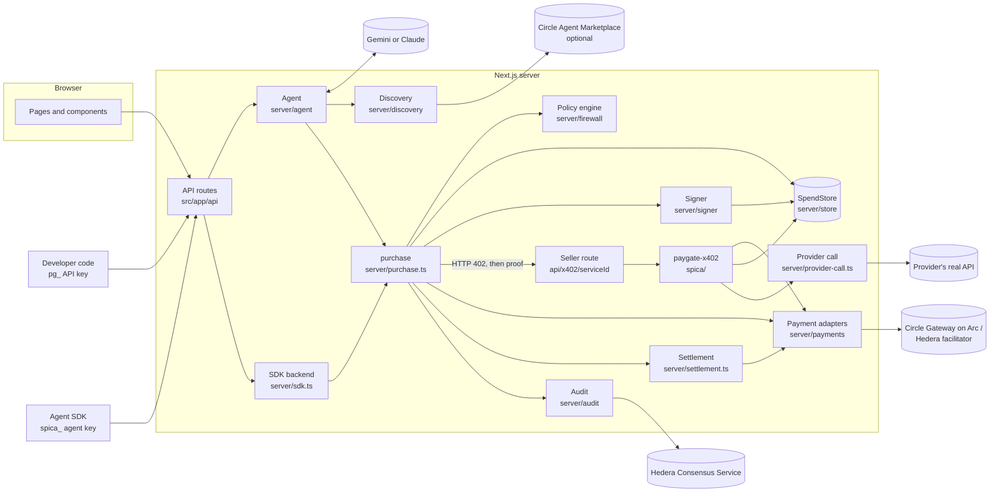
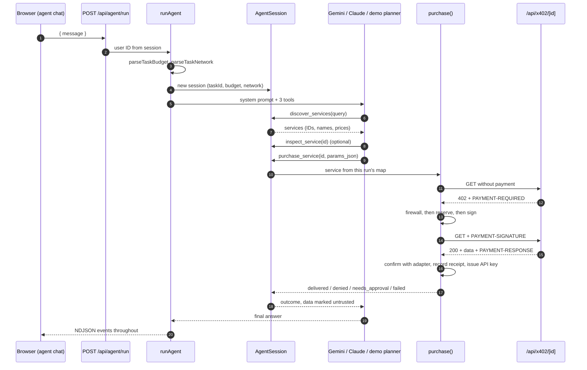
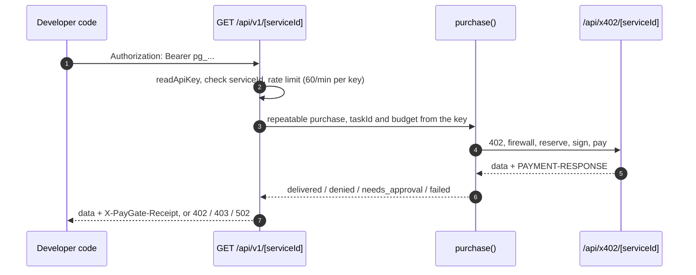

# Architecture

SPICA is one Next.js app. Pages and API routes sit on top of a server layer in `src/server/`, split into modules that each own one job. The core rule: the model decides what to buy, and only server code decides whether to pay, how much and to whom.

SPICA is both sides of every x402 payment. Its agent, its marketplace "Try" button, developer API keys and agent SDK keys all buy through one function, `purchase()`. Its seller route, `/api/x402/[serviceId]`, sells the APIs that providers list, and calls the provider's real API only after a payment is verified.

## The parts

`purchase()` reaches SPICA's own listings over HTTP, at `${PAYGATE_PUBLIC_URL}/api/x402/<id>`, exactly as it reaches a third-party seller. Circle listings are called at their own URLs.

## Modules

| Module | Owns | Must not |
| --- | --- | --- |
| `src/app/api/*` | HTTP: parse input with zod, take identity from the session or a signed key, call the server layer | Trust a user ID, price, recipient or spend total sent by the client |
| `server/http/api.ts` | `authed()` for session routes, `open()` for public routes, `toJson()` and `apiError()` | Let an exception reach the client. Failures become safe 4xx or 500 responses |
| `server/http/guard.ts` | `assertPublicUrl` and `safeFetch`: https only, no private addresses, no redirects, 20 s timeout, 1 MB cap | Exempt any origin except SPICA's own `PAYGATE_PUBLIC_URL` |
| `server/http/rate-limit.ts` | An in-memory sliding-window limiter | Be relied on for spending safety. Budgets live in the store |
| `server/auth.ts`, `server/session.ts` | Wallet sign-in sessions, nonces, the shared demo user, and signed tokens (`seal` and `unseal`) with a purpose each | Accept a token sealed for another purpose |
| `server/api-keys.ts` | Developer API keys (`pg_`) and agent keys (`spica_`), both signed tokens with a 30-day life | Store a key. Keys are signed, not saved, and cannot be revoked early |
| `server/sdk.ts` | The agent SDK backend: `agentRoute()`, `purchaseForAgent()`, `budgetFor()`, `historyFor()` | Accept a session cookie, or let an idempotency key pay twice |
| `server/agent` | One agent run: `runAgent`, `AgentSession`, the shared tools and system prompt (`tools.ts`), the Gemini planner (`gemini.ts`), the Claude tool runner (`claude.ts`), the demo planner (`demo.ts`), model fallback (`fallback.ts`) and budget and network parsing (`budget.ts`) | Hold a key, or pass a URL, amount or recipient from the model to `purchase()` |
| `server/discovery` | Turning provider listings and, when switched on, the Circle catalog into one `CatalogService` shape | Decide anything about payment |
| `server/purchase.ts` | The buyer flow, from the unpaid request to the receipt, the developer API key and the usage code | Skip the firewall, the reservation or independent confirmation |
| `server/firewall/policy.ts` | The allow, needs approval or deny decision | Do I/O. It is a pure function |
| `server/store` | All records, and the atomic reservation, in `MemoryStore` or `SupabaseStore` | Make a decision the policy engine should make |
| `server/signer` | Reading the agent's signing keys (`keys.ts`) and producing signatures (`signPayment`) | Sign without a live reservation for the exact requirement |
| `server/payments` | Per-network quoting, verifying, settling and independent confirmation: `arc.ts`, `hedera.ts`, `demo.ts`, picked by `registry.ts` | Hold buyer keys. The demo adapter is refused in live mode |
| `server/provider-call.ts` | Calling a provider's real API for the seller route, and turning failures into plain explanations | Pass on a provider's failure body, or follow a redirect with the provider's key |
| `server/secrets.ts` | Sealing provider API keys with AES-256-GCM, fingerprinting them with HMAC, and adding them to one upstream call | Return a key to a client, or let buyer query parameters replace it |
| `server/settlement.ts` | Following Arc payments that are still `settling` until Circle gives a final answer | Change a record on a failed lookup |
| `server/audit` | Publishing payment events to Hedera Consensus Service (`hcs.ts`) and recording the result (`record.ts`) | Undo a payment when publishing fails |
| `server/reputation.ts` | Scoring a service from measured calls only | Use self-reported or default values. Below 5 observations it says "not enough data" |
| `server/env.ts` | Mode, which model plans runs, which networks are live, and the integration checklist for Settings | Return a secret value. `integrations()` reports names only |
| `src/lib/*` | Browser-safe code: `money.ts`, `networks.ts`, `proof.ts` (explorer links), `usage-code.ts` | Import server code |
| `spica/` | The `paygate-x402` package: framework-neutral x402 v2 seller middleware (`withPayment`) | Know about any specific network |
| `packages/agent-sdk/` | `spica-agent-sdk`, a TypeScript client for the agent SDK routes, with its own tests | Hold payment keys or make payment decisions |
| `legacy/ens/` | Archived ENS code, kept for reference | Be built, typechecked or linted. `tsconfig.json` and `eslint.config.mjs` exclude it |

The seller middleware folder is `spica/`, but its package name is still `paygate-x402`. `tsconfig.json` and `vitest.config.mts` map that name to `spica/src/index.ts`.

## Rules between modules

These hold everywhere. Breaking one is a security bug, not a style issue.

1. **Only `src/server/signer/keys.ts` reads the agent's signing keys.** Only `signer/index.ts` and `signer/gateway.ts` import it. `payments/arc.ts` uses `signer/gateway.ts` for a read-only Gateway lookup. `server/env.ts` also reads `AGENT_PRIVATE_KEY`, but only to derive the agent's address (`isAgentWallet`) and to see which networks are configured. Keys never reach a prompt, a tool result, a log or a client bundle.
2. **Only `signPayment` signs**, and it calls `store.beginSigning` first. That call moves one reservation from `held` to `signing` exactly once, for one requirement hash.
3. **The model names services by ID only.** `AgentSession` looks the ID up among services found in the same run. Its tools take a search term, a service ID and query parameters. URLs, prices and recipients come from server-side state and the seller's real 402.
4. **Identity comes from the server, never the body.** `authed()` reads the session cookie. `agentRoute()` reads an agent key. `/api/v1/[serviceId]` reads a developer API key. Each token type has its own purpose, so none can stand in for another.
5. **Server modules that touch secrets, the environment, the network or the store start with `import 'server-only'`.** Importing one from a client component fails the build. Pure modules, such as `firewall/policy.ts`, `reputation.ts`, `agent/budget.ts`, `agent/fallback.ts` and `store/memory.ts`, skip it so tests and scripts can import them.
6. **Third-party URLs go through `assertPublicUrl` and `safeFetch`.** This covers seller URLs in `purchase()` and provider URLs in `provider-call.ts`.
7. **Settlement happens only after the provider answered with a 2xx.** `withPayment` verifies the proof, calls the handler, and settles only if the handler succeeded. A failed provider call charges nobody.
8. **Only a `verified` payment reads as paid.** `settling`, `unverified`, `failed` and `simulated` never do. The SDK maps `verified` to `settled` and nothing else.

## One agent run

The agent chat lives on the Home page, `/dashboard`, in `src/components/agent-chat.tsx`.

`agentProvider()` in `server/env.ts` picks the planner: `AGENT_PROVIDER` if its key is set, otherwise Gemini when `GEMINI_API_KEY` is set, then Claude when `ANTHROPIC_API_KEY` is set, otherwise the demo planner. One run allows at most 3 searches and 3 purchases. Every step reports progress through `emit`, which the route streams to the browser as newline-delimited JSON. See [Agent](agent.md) for the events.

On the seller side, `/api/x402/[serviceId]` wraps `deliverFromProvider` in `withPayment`. It claims the proof ID, verifies the proof with the network adapter, calls the provider's endpoint with the provider's sealed key added, then settles. A paid response can carry the provider's usage code in the `PAYGATE-USAGE-CODE` header. The provider's owner gets a `sale` or `sale_failed` activity event.

After a paid, non-failed purchase of a SPICA listing, `purchase()` issues a developer API key, unless the provider wrote its own usage code. See [Payment flow](payment-flow.md) for every branch and failure path.

## One developer API call

The key replaces a wallet. Each call is a full purchase on the agent's wallet, under the owner's Spending Firewall. All calls with one key share the key's task, so a budget stated in the chat covers them all. `repeatable: true` adds a random value to the duplicate hash, so identical calls are not refused as duplicates, and no new key is issued.

| Outcome | Response |
| --- | --- |
| Delivered | 200 with the provider's data, plus `X-PayGate-Receipt` and `X-PayGate-Payment` headers |
| Denied by the firewall | 402 with `error` and `code` |
| Needs approval | 403 with `code: "needs_approval"` |
| Failed | 502 |

## One agent SDK purchase

`POST /api/sdk/v1/purchases` takes an agent key, a `serviceId`, an `idempotencyKey` and optional query parameters. `purchaseForAgent` turns the idempotency key into a task ID, `sdk-<sha256(userId|key)>`, and gives that task a budget of exactly one payment at the listed price. A repeat with the same key replays the earlier result instead of paying again. A repeat for a different service gets 409. The firewall, reservation and signing are the same `purchase()` path. The route accepts only `network: "arc-testnet"`.

## State

| State | Where | Lifetime |
| --- | --- | --- |
| Agents, policies, reservations, approvals, transactions, activity (including usage codes, sales and audit results), providers, services, sealed provider keys, observations, used proof IDs | `SpendStore`: `MemoryStore` or `SupabaseStore` | Memory: until restart. Supabase: durable |
| The store instance | `globalThis.paygateStore` | One per process, survives dev reloads |
| Session secret when `PAYGATE_SESSION_SECRET` is unset (demo only) | `globalThis.paygateSessionSecret` | Until restart. Sessions, API keys and agent keys all stop working then |
| Demo signing secret | `globalThis.paygateDemoSecret` | Until restart |
| Session and sign-in nonce | `paygate_session` cookie (7 days), `paygate_siwe_nonce` cookie (10 minutes) | Browser |
| Developer API keys and agent keys | Held by the developer. Not stored on the server | 30 days |
| Services found in a run, search and purchase counts | `AgentSession` | One run |
| Circle catalog pages | In-memory cache in `discovery/circle.ts` | 60 seconds |
| Circle listings seen recently, so the marketplace can buy one | In-memory map in `discovery/circle.ts`, up to 2,000 | 30 minutes |
| Last settlement check per payment, and background watchers | `settlement.ts` | Checks at most every 15 s. Watchers stop after 30 minutes |
| Payment adapters | Cache in `payments/registry.ts` | One per process |
| Rate-limit windows | In-memory map in `http/rate-limit.ts` | Per server instance |
| Theme choice | `localStorage` key `paygate-theme` | Browser |

`getStore()` picks Supabase whenever it is configured, in either mode. Without Supabase it uses the memory store in demo mode, and refuses to start in live mode. See [Data model](data-model.md).

## Pages

Pages sit in three route groups. Each group has its own layout.

| Route | Group | Page |
| --- | --- | --- |
| `/` | `(site)` | Landing page |
| `/marketplace` | `(site)` | Browse, compare and quote listings. "Try" buys one call and needs sign-in |
| `/providers` | `(site)` | Public directory of providers with live listings |
| `/docs` | `(site)` | HTTP quick start: set limits, discover, quote, call, sell |
| `/login` | `(auth)` | Wallet sign-in on Arc Testnet. Returns to `?next=` or `/dashboard` |
| `/dashboard` | `(app)` | Home: the agent chat, pending approvals, 7-day spending, recent payments, today's budget, networks, activity |
| `/controls` | `(app)` | Spending limits: budgets, automatic payments, networks, allowed and blocked providers |
| `/transactions` | `(app)` | Payments list with verification status |
| `/transactions/[id]` | `(app)` | Receipt: proof links and the "Your API" usage code |
| `/provider` | `(app)` | Provider profile, register an API, revenue, your APIs, payment history |
| `/settings` | `(app)` | Mode, connected integrations, the agent SDK key card, sign out |

There is no separate agent page. The old `/agent` page and the signed-in `/marketplace` page are gone.

- **`(site)`** uses `components/spica/Navbar.tsx` and `Footer.tsx`. The navbar links to Home, Marketplace, Providers, Transactions and Docs. It shows a **Connect wallet** button, plus Login and Get Started when signed out, or Dashboard when signed in.
- **`(auth)`** uses `components/spica/AuthLayout.tsx`.
- **`(app)`** uses `components/shell.tsx`: a sidebar with Home, Spending limits, Marketplace, Transactions and Provider, then Settings and a theme switch. A top bar holds the **Connect wallet** button. A banner shows in demo mode. The shell calls `/api/overview` and sends a signed-out visitor to `/login?next=<page>`. The Marketplace link leaves the shell for the `(site)` layout.

The **Connect wallet** button is `components/wallet-button.tsx`. It reads `/api/auth/me`. To connect, it runs `signInWithArc()` from `components/wallet.ts`: it switches the wallet to Arc Testnet, gets a nonce from `/api/auth/nonce`, signs a Sign-In with Ethereum message and posts it to `/api/auth/wallet`. Once connected it shows the short address and a disconnect button that calls `/api/auth/logout`.

## API routes

| Route | Auth | Purpose |
| --- | --- | --- |
| `POST /api/auth/nonce` | Public | Start wallet sign-in |
| `POST /api/auth/wallet` | Public | Finish wallet sign-in and set the session |
| `GET /api/auth/me` | Public | The signed-in wallet, or none |
| `POST /api/auth/logout` | Public | Clear the session |
| `POST /api/agent/run` | Session | Run the agent, streamed as NDJSON (10 per minute) |
| `GET /api/overview` | Session | Everything the dashboard shows |
| `GET`, `PUT /api/policy` | Session | Read or replace spending limits |
| `POST /api/approvals/[id]` | Session | Approve or reject a held payment |
| `GET /api/transactions/[id]` | Session | One receipt, with proof links and usage code |
| `GET /api/discover` | Public | Purchasable listings as x402 endpoints, cheapest first |
| `GET /api/marketplace` | Public | Listings with measured reputation |
| `POST /api/marketplace/[id]/buy` | Session | "Try" one call from the marketplace (10 per minute) |
| `GET /api/providers` | Public | Provider directory, built from live listings |
| `GET`, `PUT /api/provider` | Session | Your provider profile, services and sales |
| `POST /api/provider/services` | Session | List an API |
| `DELETE /api/provider/services/[id]` | Session | Remove your API |
| `GET /api/x402/[serviceId]` | x402 payment | The seller route |
| `GET /api/v1/[serviceId]` | Developer API key | A paid call from your own code |
| `POST /api/sdk/v1/keys` | Session | Create an agent key (5 per minute) |
| `POST /api/sdk/v1/purchases` | Agent key | Buy one call, once per idempotency key (10 per minute) |
| `GET /api/sdk/v1/budget` | Agent key | Limits and what is left. Read-only |
| `GET /api/sdk/v1/history` | Agent key | Payments, newest first, with a cursor |
| `GET /api/sdk/v1/services/[id]` | Public | One listing with its reputation |
