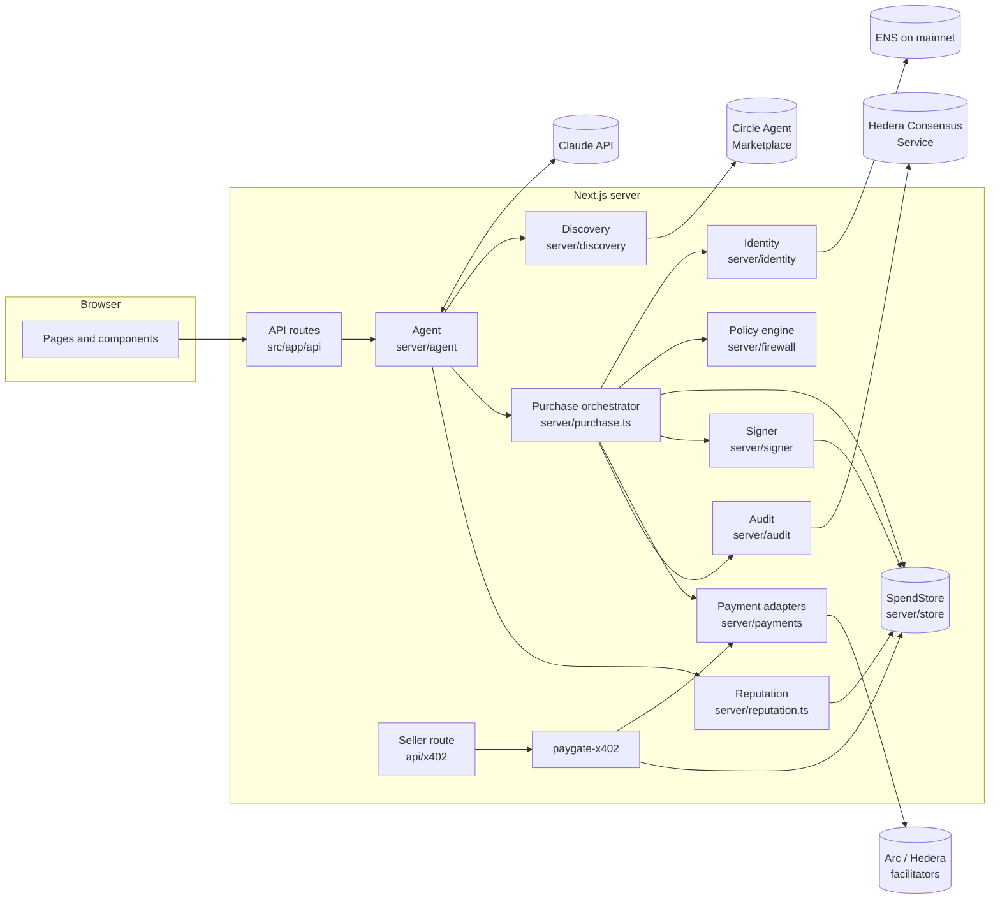
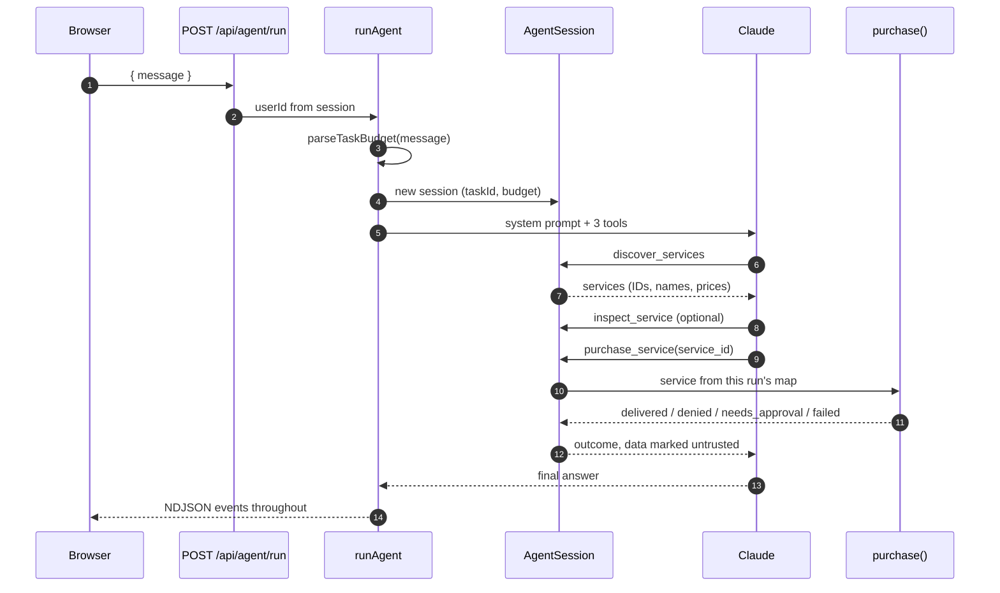

# Architecture

PayGate is one Next.js app. Pages and API routes sit on top of a server layer split into modules that each own one job. The main idea of the design is that the AI decides what to buy, and only server code decides whether to pay.

## The parts

| Module | Owns | Must not |
| --- | --- | --- |
| `src/app/api/*` | HTTP: parse input with zod, take identity from the session, call the server layer | Trust a user ID or a spend total sent by the client |
| `server/agent` | The Claude tool loop, the demo planner, task budget parsing | Hold a key, pass a URL, amount or recipient to the purchase flow |
| `server/discovery` | Turning the Circle catalog and PayGate services into one `CatalogService` shape | Decide anything about payment |
| `server/purchase.ts` | The buyer flow, quote to receipt | Skip the firewall or the reservation |
| `server/firewall/policy.ts` | The allow, needs approval or deny decision | Do I/O. It is a pure function |
| `server/store` | All records, and the atomic reservation | Compute anything the policy engine should decide |
| `server/signer` | Reading buyer keys, and producing signatures | Sign without a live reservation for the exact requirement |
| `server/payments` | Network-specific quoting, verification, settlement and independent confirmation | Hold buyer keys |
| `server/identity` | Checking an ENS name against a payment address | Say anything about API quality |
| `server/reputation.ts` | Scoring a service from measured calls | Use self-reported or default values |
| `server/audit` | Optional publishing to Hedera Consensus Service | Undo a payment when publishing fails |
| `paygate-x402` | The x402 v2 seller protocol | Know about any specific network |

## Rules between modules

These hold everywhere. Breaking one is a security bug, not a style issue.

1. **Only `src/server/signer/keys.ts` reads buyer keys.** Only the rest of `src/server/signer` imports it. Keys never reach a prompt, a tool result, a log or a client bundle.
2. **Only `signPayment` signs**, and it calls `store.beginSigning` first. That call moves one reservation from `held` to `signing` exactly once, for one requirement hash.
3. **The model names services by ID only.** `AgentSession` looks the ID up among services found in the same run. URLs, prices and recipients come from server-side state and the seller's real 402.
4. **Identity comes from the session.** `authed()` in `server/http/api.ts` wraps every signed-in route. Request bodies never carry a user ID.
5. **Server modules start with `import 'server-only'`**, so importing one from a client component fails the build.
6. **Third-party URLs go through `assertPublicUrl` and `safeFetch`**, in `server/http/guard.ts`.

## One agent run

Every step reports progress through `emit`, which the route streams to the browser as newline-delimited JSON. See [Agent](agent.md) for the events.

## State

| State | Where | Lifetime |
| --- | --- | --- |
| Policies, reservations, approvals, receipts, activity, providers, services, observations, used proofs | `SpendStore`: `MemoryStore` or `SupabaseStore` | Memory: until restart. Supabase: durable |
| The store instance | `globalThis.paygateStore` | One per process, survives dev reloads |
| Services found in a run | `AgentSession.services` | One run |
| Circle catalog pages | In-memory cache in `discovery/circle.ts` | 60 seconds |
| Rate-limit windows | In-memory map in `http/rate-limit.ts` | Per server instance |
| Demo signing secret | `globalThis.paygateDemoSecret` | Until restart |

`getStore()` picks Supabase whenever it is configured, the memory store in demo mode without it, and refuses to start live mode without it. See [Data model](data-model.md).

## Pages

| Route | Page |
| --- | --- |
| `/` | Landing page |
| `/login` | Email code sign-in |
| `/dashboard` | Spend against limits, recent activity, pending approvals |
| `/agent` | Chat with the agent, with live events and approval prompts |
| `/controls` | The spending policy editor |
| `/marketplace` | Browse the catalog with measured reputation |
| `/transactions`, `/transactions/[id]` | Receipts and their verification details |
| `/provider` | Provider profile, registered services, sales |
| `/settings` | Mode, and which integrations are configured |
