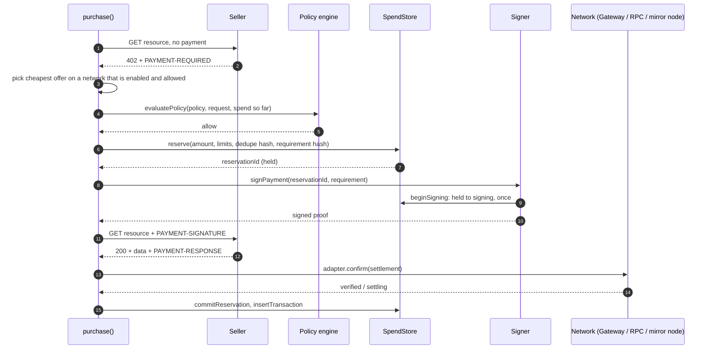
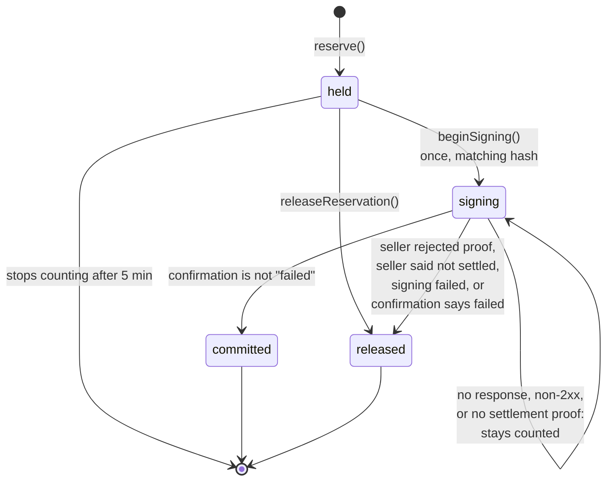

# Payment flow

How one purchase goes from a service ID to a receipt. The code is `purchase()` in `src/server/purchase.ts`. Every way of buying goes through it:

| Caller | Route or entry point | Task ID | Task budget |
| --- | --- | --- | --- |
| The agent (`AgentSession.buy`) | `POST /api/agent/run` | One per run | Parsed from the message, if stated |
| A person approving a held payment | `POST /api/approvals/:id` | The approval's task | The one stored on the approval |
| "Try API" in the marketplace | `POST /api/marketplace/:id/buy` | `marketplace-<uuid>` | None |
| The developer API, with a `pg_` key | `GET /api/v1/:serviceId` | The task signed into the key | The budget signed into the key |
| The SDK, with a `spica_` agent key | `POST /api/sdk/v1/purchases` | `sdk-<hash of user and idempotency key>` | The listed price: one payment |

See [Developer API](#developer-api-pg_-keys) and [SDK purchases](#sdk-purchases-spica_-keys) below.

## The happy path

## Step by step

1. **Check the URL.** `assertPublicUrl(service.endpoint)` in `src/server/http/guard.ts` refuses non-`https` URLs and hosts that resolve to private addresses. SPICA's own origin (`PAYGATE_PUBLIC_URL`) is exempt, because SPICA listings are sold from `/api/x402/:serviceId` on that origin. The caller's `params` are set as query parameters. They cannot change the price or recipient.
2. **Ask without paying.** `safeFetch` makes the request with no redirects, a 20 second timeout and a 1 MB cap.
   - `2xx`: the service is free. Return the data with no hold and no receipt.
   - Anything other than `402`: fail.
3. **Read the terms.** `parsePaymentRequired` reads the `PAYMENT-REQUIRED` header, or the JSON body if there is no header. It accepts x402 version 2 only.
4. **Pick an offer.** `payableNetworks` keeps networks that are active on this server (`activeNetworks()`) and in the person's `allowedNetworks`. The demo network is exempt from the person's list. If the caller named a network (`preferredNetwork`), only that one is kept. `selectRequirement` then takes the cheapest offer. If none is left, deny with `network_not_allowed`. The reason says whether the person's list or the server's networks were the cause.
5. **Fingerprint it.** `requirementHash` in `src/server/signer/hash.ts` hashes scheme, network, asset, amount, `payTo` and the resource URL (with its query parameters). Approvals and reservations are bound to this hash.
6. **Ask the firewall.** `evaluatePolicy` gets the policy, the quote (with the price listed in the catalog and the task budget) and current spend. A matching approval waives the approval checks only. The decision is written as a `policy_allow`, `policy_deny` or `policy_needs_approval` activity event. See [Spending Firewall](spending-firewall.md).
   - `deny`: stop and return the code and reason.
   - `needs_approval`: create an approval that expires in 10 minutes, and stop.
7. **Reserve.** `store.reserve` rejects duplicates and re-checks the task, daily and monthly budgets, atomically. This is what stops concurrent requests overspending. The dedupe hash is the user plus the requirement hash. For repeatable calls (developer API and SDK) a random value is added, so identical calls are not treated as duplicates.
8. **Sign.** `signPayment` in `src/server/signer/index.ts` calls `store.beginSigning`, which succeeds once, for this reservation and this requirement hash. Then it signs with the network's scheme.
9. **Pay.** Retry the request with `PAYMENT-SIGNATURE`.
10. **Confirm independently.** Decode `PAYMENT-RESPONSE`, then call `adapter.confirm`. SPICA checks with Circle Gateway, the Arc transaction receipt or the Hedera mirror node. It does not take the seller's word. See [Networks and adapters](networks-and-adapters.md).
11. **Record.** Release the reservation if confirmation says the payment failed. Otherwise commit it. Write the transaction (the receipt).
12. **Usage code.** For a paid call that did not fail, attach a usage code. See [Usage codes and developer keys](#usage-codes-and-developer-keys).
13. **Report.** Write a `payment_recorded` activity event and emit a `receipt` event.
14. **Audit and follow-up.** `auditPayment` (`src/server/audit/record.ts`) publishes to Hedera Consensus Service in the background, if HCS is configured and the status is `verified` or `settling`. If the status is `settling`, `watchSettlement` starts checking it. See [Settlement checking](#settlement-checking).

Every attempt that calls the seller also records an **observation** (reachable, succeeded, paid, latency, quoted price). Reputation is computed from these.

## When things go wrong

The key rule: **a hold is released only when SPICA knows no money moved.** Once a proof has left the server, the payment might have settled, so the amount stays counted against the person's limits.

| What happened | Hold | Receipt | Result |
| --- | --- | --- | --- |
| URL unsafe | none | none | `denied` (`unsafe_url`) |
| Seller unreachable, or answered something other than `2xx` or `402` | none | none | `failed` |
| Terms unreadable | none | none | `failed` |
| No offer on a payable network | none | none | `denied` (`network_not_allowed`) |
| Firewall denies | none | none | `denied` with the rule's code |
| Firewall needs approval | none | none | `needs_approval`, approval created |
| Reservation refused (duplicate, or budget used by a concurrent request) | none | none | `denied` (`duplicate`, `task_budget`, `daily_limit` or `monthly_limit`) |
| Signing failed or was refused | released | none | `failed` |
| No response after sending the proof | **stays counted** | `unverified` | `failed`, held for review |
| Seller answered `402` again (rejected the proof) | released | `failed` | `failed`, no money moved |
| SPICA's own seller answered non-2xx with `PAYMENT-NOT-SETTLED` | released | `failed` | `failed`, "Nothing was charged" |
| Any other non-2xx after the proof | **stays counted** | `unverified` | `failed`, held for review |
| Seller sent data without `PAYMENT-RESPONSE` | **stays counted** | `unverified` | `delivered` |
| Confirmation says the payment failed | released | `failed` | `delivered` |
| Confirmation could not be completed | committed | `unverified` | `delivered` |
| Confirmed | committed | `verified` / `settling` / `simulated` | `delivered` |

Notes:

- "Stays counted" means the reservation stays in `signing`. It is neither committed nor released, and it never expires.
- `PAYMENT-NOT-SETTLED` is trusted only from SPICA listings (`source: 'paygate'`). The seller route is SPICA's own code, which sets it only when settlement never ran. A Circle catalog seller that sends it is not believed.
- When a seller rejects the proof, known codes get a plain reason. For example, `self_transfer` means the provider's payout wallet is the agent's own wallet.
- When confirmation says `failed`, the seller's data is still returned, with a `failed` receipt.

## Reservation lifecycle

- `held`, `signing` and `committed` reservations count against limits.
- A `held` reservation that never reached signing stops counting after 5 minutes (`HOLD_TTL_MS` in `src/server/store/windows.ts`).
- A `signing` reservation never expires. Only a caller that passes `paymentNotSent: true` can release it.
- A `committed` reservation is never released. This includes a payment that was `settling` and later turned out `failed` (see [Settlement checking](#settlement-checking)).

## Receipt statuses

| Status | Meaning | Set by |
| --- | --- | --- |
| **Verified** | Settlement confirmed onchain or by consensus | Arc receipt with a matching USDC transfer, Gateway transfer `confirmed`/`completed`, Hedera mirror node result `SUCCESS` with a matching credit |
| **Settling** | Circle Gateway accepted the transfer, batch settlement pending | Gateway transfer in any other non-failed state |
| **Unverified** | Data may have been delivered, but payment could not be confirmed | No reference, transfer does not match the quote, lookup failed, mirror node not indexed after 5 tries, no response, non-2xx, data without a settlement proof |
| **Failed** | The payment did not happen | Seller rejected the proof, SPICA's seller reported no settlement, transaction reverted, Gateway reports failure, Hedera result not `SUCCESS` |
| **Simulated** | Demo mode, no money moved | Demo adapter |

A public explorer link (`settlementProof` in `src/lib/proof.ts`) exists only for `verified` receipts: the Arc Testnet explorer for Arc, HashScan for Hedera. While a payment is `settling`, its reference is a Gateway transfer ID that no explorer knows.

The SDK reports these statuses with other names: `verified` is `settled`, `unverified` is `uncertain`. The others keep their names.

## Settlement checking

Circle Gateway settles Arc payments in batches, after the receipt is written. `src/server/settlement.ts` asks again while a receipt is `settling`.

- **`refreshTransaction`** rebuilds the requirement from the receipt and calls `adapter.confirm` with the stored reference. It asks about one receipt at most once every 15 seconds (per server process). It changes the receipt only on a final answer, `verified` or `failed`. A failed lookup leaves the receipt as it was. On a change it publishes a new audit message, which carries the onchain reference.
- **In the background.** `purchase()` calls `watchSettlement` for every `settling` receipt. It re-reads the receipt every 15 seconds, for up to 30 minutes, and stops once it is no longer `settling`.
- **On page loads.** `GET /api/transactions/:id` refreshes that receipt. `GET /api/overview` refreshes up to 8 settling receipts per load, oldest first. The SDK history and SDK replays do the same.
- **The settle script.** `npm run payments:settle` runs `scripts/settle-pending.mts`. It reads `SUPABASE_URL` and `SUPABASE_SERVICE_ROLE_KEY` from `.env.local`, finds every `settling` receipt for every user, refreshes each one, and prints a count per resulting status. Use it for accounts nobody reopens. It needs Supabase; the memory store has nothing to read.

What settlement checking does not do:

- It never re-checks `unverified` receipts. Those stay counted until handled by hand.
- It does not touch reservations. A `settling` payment that later becomes `failed` keeps its committed reservation, so the amount stays counted.

## Usage codes and developer keys

After a paid call that did not fail, `purchase()` attaches a short code snippet to the receipt. It is not added for repeatable calls (developer API and SDK).

| Service | Code |
| --- | --- |
| SPICA listing whose provider wrote a usage code | The provider's code, sent by the seller route in the `PAYGATE-USAGE-CODE` header (base64, at most 3 lines and 600 characters) |
| Other SPICA listing | A `fetch` snippet for `GET /api/v1/:serviceId` with a new `pg_` developer key |
| Circle catalog service | A generic x402 snippet. No key is issued |

- The header is read only from SPICA listings, and the seller route sends it only with a paid, settled response. A listing or a `402` never reveals it.
- The code is saved as a `usage_code` activity event and returned with the receipt (`GET /api/transactions/:id`) and in the `receipt` event.
- If the server cannot sign keys (live mode without `PAYGATE_SESSION_SECRET`), the generic snippet is used instead.
- Usage codes come from `src/lib/usage-code.ts`. Keys come from `src/server/api-keys.ts`.

## Developer API (`pg_` keys)

`GET /api/v1/:serviceId` (`src/app/api/v1/[serviceId]/route.ts`) lets a developer call a SPICA listing from their own code. The key stands in for a wallet: each call is a full `purchase()` on the owner's agent wallet, under the owner's Spending Firewall.

1. Read `Authorization: Bearer pg_...`. An invalid, expired or wrong-purpose key gets `401`.
2. The key's signed `serviceId` must match the route, or `403`.
3. Rate-limit to 60 calls a minute per key task, or `429`.
4. The service must be a purchasable SPICA listing, or `404`. Circle catalog services are not sold here.
5. Run `purchase()` with the user, agent, task, budget and network signed into the key. Query parameters are passed through. The call is repeatable, so identical calls are not deduplicated and no new key is issued.
6. Map the result:

| Outcome | Status | Body |
| --- | --- | --- |
| `delivered` | `200` | The seller's data, with `X-PayGate-Receipt` (receipt ID) and `X-PayGate-Payment` (receipt status) headers when a payment was made |
| `denied` | `402` | `{ error, code }` |
| `needs_approval` | `403` | `{ error, code: "needs_approval" }` |
| `failed` | `502` | `{ error }` |
| Server error | `503` | `{ error }` |

All calls with one key share its task, so the budget stated in the original chat covers every call. Once that budget is spent, calls are denied with `task_budget`. A key from a chat with no stated budget is bounded only by the owner's policy.

## SDK purchases (`spica_` keys)

`POST /api/sdk/v1/purchases` (`purchaseForAgent` in `src/server/sdk.ts`) buys one call for an agent that holds a `spica_` agent key. The body is `serviceId`, `idempotencyKey` (8 to 200 characters), `network` (`arc-testnet` only) and up to 10 `params`. The route allows 10 purchases a minute per user.

1. The idempotency key becomes the task: `sdk-` plus a hash of the user and the key.
2. If the user's latest 200 receipts include that task, return it again (`replayed: true`, no data), after refreshing a `settling` status. If a pending approval has that task, return it again. A different `serviceId` for the same key gets `409 idempotency_conflict`.
3. Resolve the service (SPICA listing or recently seen Circle listing). It must be purchasable and have a listed price.
4. Run `purchase()` with the listed price as the task budget, so one key pays at most once. The call is repeatable.
5. Map the result:

| Outcome | Status | Body `status` |
| --- | --- | --- |
| Paid | `200` | `settled`, `settling`, `uncertain`, `failed` or `simulated`. `uncertain` and `failed` include an `error` |
| Free | `200` | `free` |
| Needs approval | `202` | `pending_approval`, with `approvalId` and `expiresAt` |
| Denied with `task_budget` or `duplicate` | `409` | `code: duplicate_request` (a payment with this key is in progress or unresolved) |
| Other denial | `403` | The deny code |
| Failed with no receipt | `200` | `uncertain` |

The other SDK routes are `GET /api/sdk/v1/budget` (limits and spend, read-only), `GET /api/sdk/v1/history` (latest 200 receipts, paged) and the public `GET /api/sdk/v1/services/:id`. A signed-in person creates agent keys with `POST /api/sdk/v1/keys`. See [Security](security.md) and the README's [Buy through SPICA from your app or agent](../README.md#3-buy-through-spica-from-your-app-or-agent).

## The seller side

SPICA also sells, at `GET /api/x402/:serviceId` (`src/app/api/x402/[serviceId]/route.ts`):

1. Rate-limit by client IP (first `x-forwarded-for` entry): 120 requests a minute.
2. Resolve the service. It must be an enabled registered listing with a provider. Load the provider's stored API key, if the listing has one. A listing with no payable offer gets `404`.
3. Build one offer per network the listing supports and this server has active (only `demo` in demo mode). An offer whose payout address is the agent's own wallet is dropped.
4. Wrap delivery in `withPayment` from the `paygate-x402` package (source in `spica/`), with a replay guard backed by `store.claimProof` and `store.releaseProof`, and an `onEvent` hook that records `sale` and `sale_failed` activity for the provider.
5. Any unexpected error returns `503`.

`withPayment` checks that the signed requirement exactly matches a current offer, claims the proof ID once, and verifies the payment with the network adapter. Then it runs delivery. Delivery runs **before** settlement. A non-2xx delivery means no settlement, no charge, a released proof claim and a `PAYMENT-NOT-SETTLED` header. See [`spica/README.md`](../spica/README.md) for the middleware's own steps.

### Calling the provider

Delivery is `deliverFromProvider` in `src/server/provider-call.ts`:

1. Check the provider's endpoint with `assertPublicUrl`.
2. Copy every query parameter from the buyer's request onto the endpoint URL.
3. Add the provider's API key last, so a buyer's query parameter with the same name cannot replace it. The key is decrypted from its stored, encrypted form (`openSecret` in `src/server/secrets.ts`) and placed as the listing says:

   | Placement | Sent as |
   | --- | --- |
   | `bearer` | `Authorization: Bearer <key>` |
   | `header` | A header with the name the provider chose |
   | `query` | A query parameter with the name the provider chose |

4. Fetch with `safeFetch`. Redirects stay off, so the key reaches only this URL.
5. On a network error or timeout, return `502`. On a non-2xx answer, return the same status (`502` if it is below 400). The message is built from the status and the host only. The provider's body is never passed on, because it can echo the key and an agent could read it as an instruction. Server logs get a scrubbed copy.
6. On success, return the provider's body and content type, plus the provider's usage code in `PAYGATE-USAGE-CODE` if it wrote one. `withPayment` returns this only after settlement.
