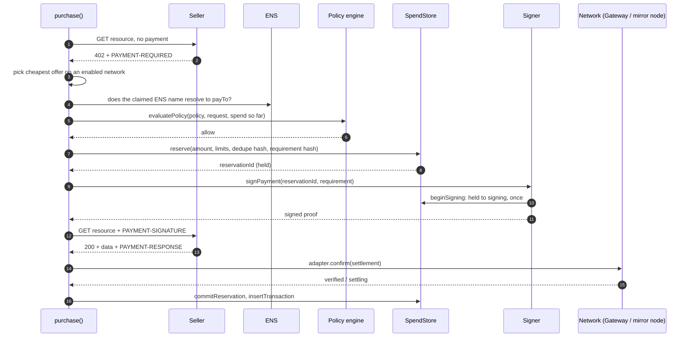
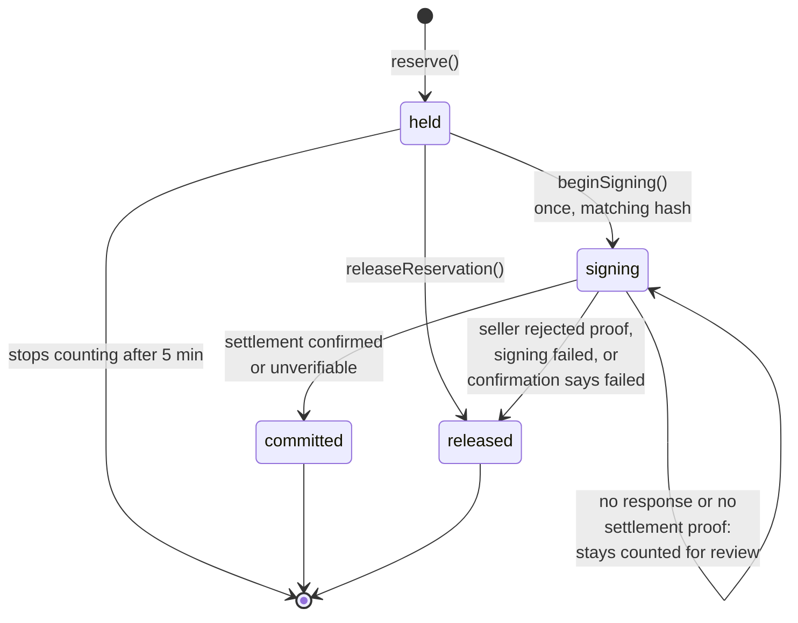

# Payment flow

How one purchase goes from a service ID to a receipt. The code is `purchase()` in `src/server/purchase.ts`. It is called by the agent (`AgentSession.buy`) and again when a person approves a held payment (`POST /api/approvals/:id`).

## The happy path

## Step by step

1. **Check the URL.** `assertPublicUrl(service.endpoint)` refuses non-`https` URLs and private addresses. PayGate's own origin is allowed, because built-in services live there. The agent's `params` are added as query parameters. They cannot change the price or recipient.
2. **Ask without paying.** `safeFetch` makes the request with no redirects, a 20 second timeout and a 1 MB cap.
   - `2xx`: the service is free. Return the data with no transaction.
   - Anything other than `402`: fail.
3. **Read the terms.** `parsePaymentRequired` reads the `PAYMENT-REQUIRED` header, or the JSON body if there is no header. It accepts x402 version 2 only.
4. **Pick an offer.** `selectRequirement` keeps offers on networks this deployment can pay (`activeNetworks()`), then takes the cheapest. If none is left, deny with `network_not_allowed`.
5. **Fingerprint it.** `requirementHash` hashes scheme, network, asset, amount, `payTo` and the resource URL. Approvals and reservations are bound to this hash.
6. **Check identity.** For Arc offers, `checkProviderIdentity` compares the provider's ENS name with `payTo`. Hedera and demo offers get `none`. See [Discovery, identity and reputation](discovery-identity-reputation.md).
7. **Ask the firewall.** `evaluatePolicy` gets the policy, the quote (including the listed catalog price and the task budget), the identity result and current spend. A matching approval waives the approval threshold only. See [Spending Firewall](spending-firewall.md).
   - `deny`: stop and return the code and reason.
   - `needs_approval`: create an approval that expires in 10 minutes, and stop.
8. **Reserve.** `store.reserve` re-checks the daily, monthly and task budgets, and rejects duplicates, atomically. This is what stops concurrent requests overspending.
9. **Sign.** `signPayment` calls `store.beginSigning`, which succeeds once, for this reservation and this requirement hash. Then it signs with the network's scheme.
10. **Pay.** Retry the request with `PAYMENT-SIGNATURE`.
11. **Confirm independently.** Decode `PAYMENT-RESPONSE`, then call `adapter.confirm`. PayGate checks with Circle Gateway, the Arc transaction receipt or the Hedera mirror node. It does not take the seller's word.
12. **Record.** Commit the reservation, unless confirmation says the payment failed, in which case release it. Write the transaction and a `payment_recorded` activity event, and emit a `receipt` event.
13. **Audit (optional).** If Hedera Consensus Service is configured and the status is `verified` or `settling`, publish an audit message in the background.

Every attempt also records an **observation** (reachable, succeeded, paid, latency, quoted price) that feeds the service's reputation.

## When things go wrong

The key rule: **a hold is released only when PayGate knows no money moved.** Once a proof has left the server, the payment might have settled, so the amount stays counted against the person's limits until someone reviews it.

| What happened | Hold | Receipt | Result |
| --- | --- | --- | --- |
| URL unsafe | none | none | `denied` (`unsafe_url`) |
| Seller unreachable, or non-402 error, before paying | none | none | `failed` |
| Terms unreadable, or no payable network | none | none | `failed` / `denied` |
| Firewall denies | none | none | `denied` |
| Firewall needs approval | none | none | `needs_approval` |
| Reservation refused (budget used by a concurrent request, or duplicate) | none | none | `denied` |
| Signing failed | released | none | `failed` |
| No response after sending the proof | **stays counted** | `unverified` | `failed`, held for review |
| Seller answered `402` again (rejected the proof) | released | `failed` | `failed`, no money moved |
| Seller answered non-2xx after the proof | **stays counted** | `unverified` | `failed`, held for review |
| Seller sent data without `PAYMENT-RESPONSE` | **stays counted** | `unverified` | `delivered` |
| Confirmation says the payment failed | released | `failed` | `delivered` |
| Confirmation could not be completed | committed | `unverified` | `delivered` |
| Confirmed | committed | `verified` / `settling` / `simulated` | `delivered` |

## Reservation lifecycle

- `held` and `signing` reservations count against limits, and so do `committed` ones.
- A `held` reservation that never reached signing stops counting after 5 minutes (`HOLD_TTL_MS`).
- A `signing` reservation never expires. It can only be released by a caller that knows the payment was not sent.

## Receipt statuses

| Status | Meaning | Set by |
| --- | --- | --- |
| **Verified** | Settlement confirmed onchain or by consensus | Arc receipt, Gateway transfer `confirmed`/`completed`, Hedera mirror node |
| **Settling** | Circle Gateway accepted the transfer, batch settlement pending | Gateway transfer in any other state |
| **Unverified** | Data may have been delivered, but payment could not be confirmed | No reference, mismatched transfer, lookup failed, no response |
| **Failed** | The payment did not happen | Seller rejected it, transaction reverted, Gateway reports failure |
| **Simulated** | Demo mode, no money moved | Demo adapter |

There is no reconciliation screen yet, so unverified payments stay counted until handled manually.

## The seller side

PayGate also sells, at `GET /api/x402/:serviceId` (`src/app/api/x402/[serviceId]/route.ts`):

1. Rate-limit by client IP: 120 requests a minute.
2. Resolve the service: a built-in cricket service, or an enabled registered service with its provider.
3. Wrap delivery in `withPayment` from `paygate-x402`, with one offer per active network, a replay guard backed by `store.claimProof`, and an `onEvent` hook that records `sale` and `sale_failed` activity for the provider.
4. Delivery runs **before** settlement. For built-ins, it loads the cricket feed and returns `503` if real data is unavailable in live mode. For registered services, it fetches the provider's endpoint through `safeFetch`. A failed delivery means no settlement and no charge.

See [`paygate-x402/README.md`](../paygate-x402/README.md) for the middleware's own steps.
